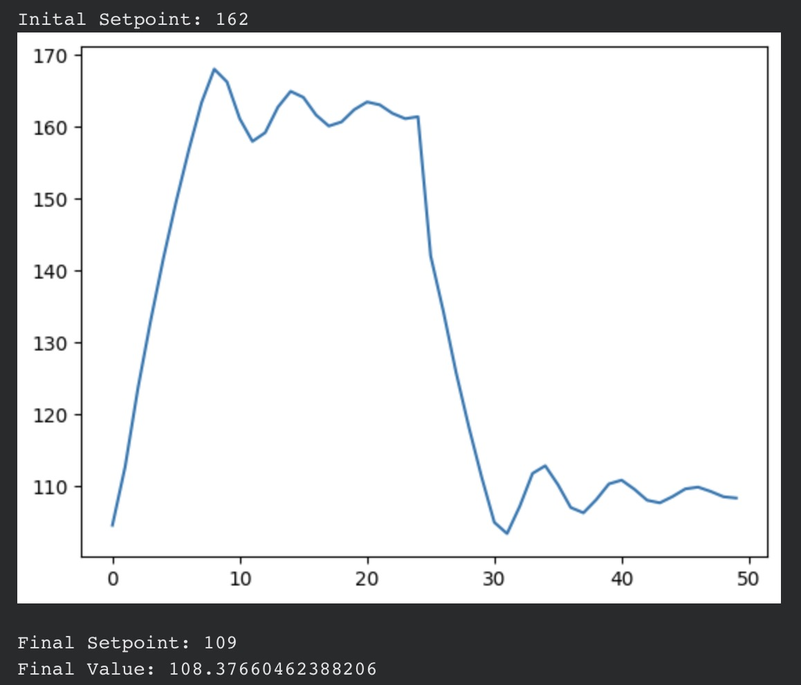

# PID_learning
PID_learning is a simple python script simulating a basic PID controller. In creating this project, I was able to learn the mathematics behind a PID controller while also improving my programming skills.

